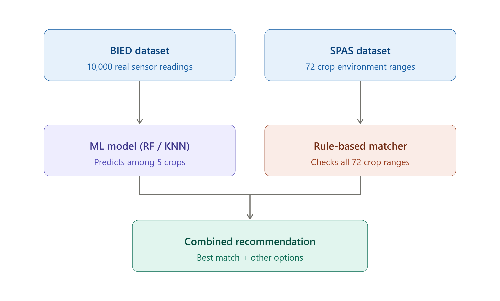
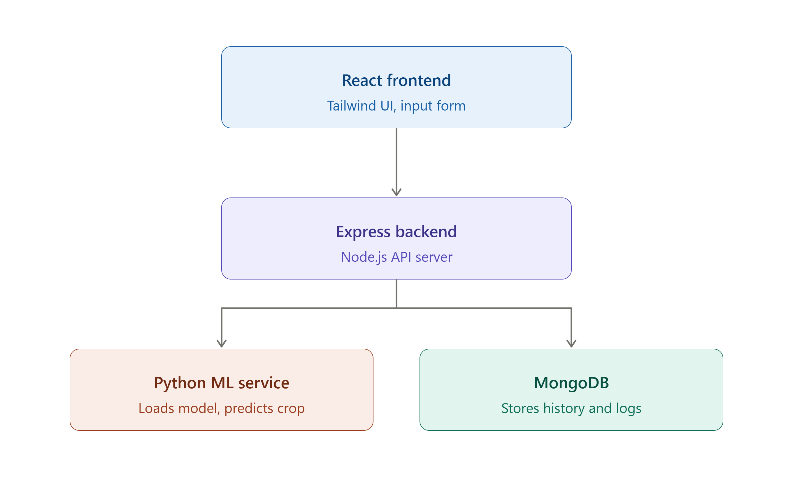

# Detailed Implementation Guide for the Smart Agricultural Decision Support System

## Project Title
Smart Agricultural Decision Support System

## 1. Project idea in one line
This project is a web-based system that recommends the best crop for a Bangladeshi farmer by using real environmental data and crop knowledge together.

## 2. What the two datasets mean
- **SPAS-Dataset-BD** is the crop knowledge book. It contains crop-related information such as crop type, temperature, humidity, and season. It is historical and static.
- **BIED** is the real-world sensor book. It contains environmental readings such as temperature, humidity, AQI, CO₂, soil moisture, rainfall, and light intensity. It is dynamic and closer to real daily conditions.

## 3. Proposed Approach

The proposed system follows a **two-layer decision support approach** instead of creating a single merged dataset.

### Part A: BIED Machine Learning Model

The BIED dataset contains more than 10,000 environmental records collected from different regions of Bangladesh. These records include:
* Temperature
* Humidity
* Rainfall
* Soil Moisture
* Soil pH
* Light Intensity
* Season

A machine learning model (Random Forest) will be trained using the BIED dataset to learn the relationship between environmental conditions and crop suitability.

The model acts as the **primary recommendation engine** and provides the most suitable crop based on current environmental conditions.

### Part B: SPAS Reference Layer

The SPAS dataset contains information about 73 Bangladeshi crops and their preferred environmental conditions.

Instead of using SPAS for model training, it will be used as a **crop knowledge base** to:
* Validate the machine learning prediction.
* Provide alternative crop suggestions.
* Explain why a crop is recommended.
* Extend recommendations beyond the limited crops available in the BIED dataset.

The SPAS layer acts as a **secondary verification and recommendation system**.

## 4. Why We Do Not Create One Combined Dataset

Although both datasets are agriculture-related, directly combining them is not suitable for machine learning because:

1. SPAS does not contain Soil Moisture, Soil pH, Rainfall, and Light Intensity information.
2. Many fields would become empty (missing values).
3. Filling missing values with artificial numbers may introduce incorrect patterns.
4. The model would lose important environmental information.
5. Experimental testing showed that model performance decreases when only common features are used.

Therefore, keeping the datasets separate produces more reliable and accurate recommendations.

## 5. Example of the Complete Decision Pipeline

Suppose a farmer wants a recommendation for the following conditions:

| Feature       | Value    |
| ------------- | -------- |
| Temperature   | 30°C     |
| Humidity      | 72%      |
| Rainfall      | 8 mm     |
| Soil Moisture | 60%      |
| Soil pH       | 6.5      |
| Season        | Kharif-2 |

### Step 1: BIED Model Prediction

The trained Random Forest model analyzes the environmental conditions and predicts:

| Crop   | Confidence |
| ------ | ---------- |
| Rice   | 87%        |
| Tomato | 8%         |
| Jute   | 3%         |
| Wheat  | 1%         |
| Potato | 1%         |

**Primary Recommendation:** Rice

### Step 2: SPAS Reference Validation

The SPAS reference layer checks all 73 crops and finds crops whose environmental ranges match the current conditions.

Matching crops:
* Aman Rice
* Aus Rice
* Jute
* Sugarcane
* Betelnut

### Step 3: Final System Output

**Recommended Crop:** Aman Rice  
**Confidence Score:** 87%  

**Alternative Crops:**
* Aus Rice
* Jute
* Sugarcane

**Reason:**  
The current temperature, humidity, rainfall, and soil conditions closely match the preferred environmental requirements of Aman Rice.

## 6. Overall Workflow

<div align="center">
  
  <br/>
  <em>Figure 1: Fastone Two-Track Hybrid Architecture for the Smart Agricultural Decision Support System.</em>
</div>

```text
Farmer Input
      |
      v
Environmental Data
      |
      v
BIED Machine Learning Model
(Random Forest)
      |
      v
Primary Crop Prediction
      |
      v
SPAS Reference Layer
(73 Crop Knowledge Base)
      |
      v
Validation + Alternative Crops
      |
      v
Final Recommendation
      |
      v
Result Display
```

## 7. Pipeline Benefits

This approach allows the system to use real environmental intelligence from BIED while also utilizing the broader agricultural knowledge available in SPAS. As a result, the system provides more practical, explainable, and Bangladesh-focused crop recommendations.

## 8. Functional requirements
Functional requirements describe what the system must do.

| ID | Requirement | Description |
|---|---|---|
| FR1 | User input | The system shall accept environmental or location-based input from the user. |
| FR2 | Data preprocessing | The system shall clean and prepare input data before prediction. |
| FR3 | Crop prediction | The system shall predict the most suitable crop using the trained model. |
| FR4 | Reference checking | The system shall compare the predicted result with SPAS-based crop reference data. |
| FR5 | Alternative crops | The system shall show other crops that are also suitable. |
| FR6 | Explanation output | The system shall provide a short reason for the recommendation. |
| FR7 | Result display | The system shall show the recommendation in a simple web interface. |
| FR8 | History storage | The system may store past inputs and results for future review. |

## 9. Non-functional requirements
Non-functional requirements describe how the system should behave.

| ID | Requirement | Description |
|---|---|---|
| NFR1 | Usability | The interface should be simple and easy for non-technical users. |
| NFR2 | Performance | The system should return a result quickly after input is submitted. |
| NFR3 | Reliability | The system should give stable and repeatable predictions for the same input. |
| NFR4 | Maintainability | The code should be easy to update, test, and improve. |
| NFR5 | Scalability | The system should allow future expansion with more datasets or models. |
| NFR6 | Security | User input and stored data should be handled safely. |
| NFR7 | Portability | The web app should run on common browsers and devices. |
| NFR8 | Readability | The system should show results in clear language for students and farmers. |

## 10. Model Selection

For this project, the best choice is to compare two simple models and then keep the better one as the main model.

- **Random Forest**: Recommended as the main model because it handles complex relationships well and can explain feature importance.
- **K-Nearest Neighbors (KNN)**: Recommended as a comparison model because it is easy to explain and works like a similarity search.

Why this pair is good: Random Forest is strong and practical. KNN is simple and understandable. Together they provide a good thesis comparison.

## 11. Methodology: Step-by-Step Implementation

1. Collect the datasets and understand their columns.
2. Clean missing values, wrong labels, and inconsistent formats.
3. Select the features that will be used for prediction.
4. Split the data into training and testing parts.
5. Train Random Forest and KNN models on BIED.
6. Compare accuracy, precision, recall, and F1-score.
7. Choose the best model as the main recommendation engine.
8. Build the SPAS reference layer for additional crop suggestions.
9. Develop the web frontend, APIs, and backend.
10. Connect the backend to the trained model.
11. Test with sample inputs and check the output quality.
12. Prepare documentation, results, and defense slides.

## 12. Result Output Design

The result page will display a comprehensive but easy-to-read recommendation:

* **Recommended Crop**: e.g., *Aman Rice*
* **Suitability Score**: e.g., *91%*
* **Model Confidence**: e.g., *87%*
* **Alternative Crops**: e.g., *Aus Rice, Jute, Sugarcane*
* **Risk Level**: e.g., *Low Risk*
* **Recommendation Reason**: 
  > The current temperature, humidity, rainfall, soil moisture, and seasonal conditions are highly suitable for Aman Rice cultivation in the selected area.

## 13. User Interface Plan

The interface should stay simple. The user should not need to understand machine learning. The system hides complexity and shows only the useful result.

<div align="center">
  
  <br/>
  <em>Figure 2: Web Application UI Architecture for user interactions.</em>
</div>

### 13.1 Home Page

The home page will contain a crop recommendation form with the following simple inputs:

**Location Information:**
* District (Dropdown)
* Upazila (Dropdown)

**Soil Information:**
* Soil Type (Radio Buttons)
  * Clay Soil
  * Loamy Soil
  * Sandy Soil
  * Don't Know

**Optional Feature:**
* 📍 **Use My Current Location**: Automatically detects the user's location and fills the district and upazila information.

**Action Button:**
* Get Crop Recommendation

### 13.2 Automatic Data Collection

After the user submits the form, the system automatically collects or estimates the required environmental values. *The user does not need to enter these manually.*

### 13.3 API Integration Strategy

To fetch real-time environmental data seamlessly without physical sensors, we will utilize highly reliable and cost-effective APIs:

* **Open-Meteo API (Preferred):**
  * **Cost:** Completely Free (No API key required).
  * **Data Provided:** Temperature, Humidity, Rainfall, Cloud Cover, Wind Speed.
  * **Why it's best:** It offers excellent coverage for Bangladesh and doesn't have the restrictive free-tier limits found in alternatives like OpenWeatherMap.
* **NASA POWER API:**
  * **Cost:** Free (Satellite-based data).
  * **Data Provided:** Soil Moisture, Solar Radiation.
  * **Why it's used:** Crucial for obtaining land and moisture metrics that standard weather APIs do not supply.

**Handling Specialized Variables:**
* **Light Intensity:** Automatically estimated using Solar Radiation and Cloud Cover data from the APIs.
* **Soil pH:** Since no remote API can detect specific land pH, we rely on the farmer's selected **Soil Type** (Clay, Sandy, or Loamy) to estimate a highly accurate average pH value. *(Note: Future expansions could incorporate IoT sensors for this).*

### 13.4 User Flow

```text
User Opens Website
        |
        v
Select District & Upazila
        |
        v
Select Soil Type
        |
        v
Click "Get Crop Recommendation"
        |
        v
System Collects Environmental Data
        |
        v
ML Model Prediction
        |
        v
SPAS Validation Layer
        |
        v
Display Recommendation Result
```

## 14. Testing Plan

1. **Unit testing** - test small parts like input checks and prediction functions.
2. **Integration testing** - test the full flow from input to result.
3. **Model testing** - measure how well the model predicts the right crop.
4. **Usability testing** - ask users or teachers to check whether the interface is easy to use.
5. **Validation testing** - check whether the output makes sense for sample environmental conditions.

## 15. Risks and Mitigation

| Risk | Possible problem | How to reduce it |
|---|---|---|
| Data mismatch | Different columns and formats | Use clean preprocessing and separate dataset roles. |
| Weak accuracy | Some crops may look similar | Try model comparison and feature tuning. |
| User confusion | Interface may be too technical | Keep the UI simple and use clear labels. |
| Time pressure | Documentation and coding may take longer | Work in phases and finish one module at a time. |

## 16. Expected Outcome

At the end of the project, the system should be able to take environmental input and suggest a crop in a way that is easy to understand, practical for Bangladesh, and useful for a class presentation or thesis defense.

- A working web application.
- A trained crop recommendation model.
- A SPAS-based reference layer.
- A clear explanation for each recommendation.
- A strong academic project report.

## 17. Final Conclusion

The best implementation strategy is not to force SPAS and BIED into one training file. The best strategy is to let each dataset do its own job: BIED trains the model, and SPAS supports the explanation and crop reference layer. This gives a cleaner system, a stronger thesis story, and a more believable result for teachers and examiners.
